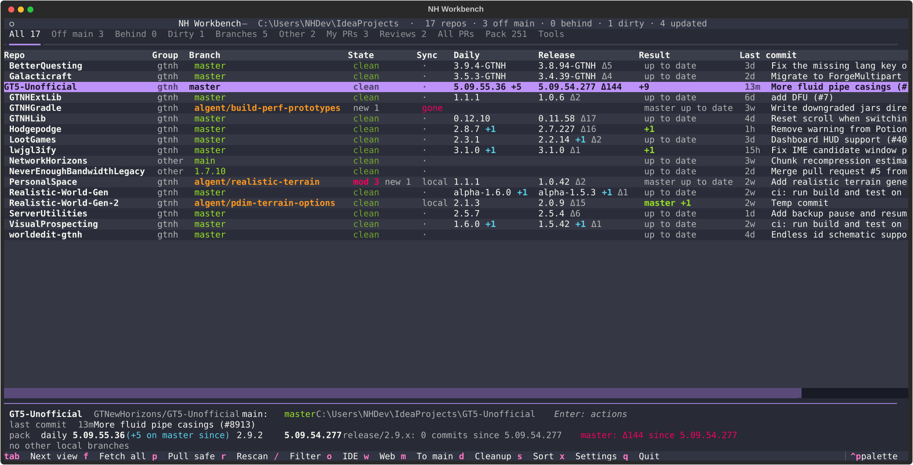

# NH Workbench

Keeps a folder full of GTNH mod checkouts under control:

- which repos are off their main branch, behind, or dirty, at a glance
- fetch everything, and fast-forward main where it is safe, even while you are on a feature branch
- local branches with their PR, and cleanup of the merged ones
- your PRs, your review requests, and every open PR of the org, sortable by size
- where each repo stands in the pack: daily and release versions, what still needs a backport
- clone missing pack mods, download the closed-source jars
- read spark profiles as text, for people and coding agents
- in the terminal, or in a desktop window with the same tabs and keys

Works on Windows, Linux and macOS. Everything else is in the [wiki](https://github.com/Algent/NH-Workbench/wiki).



## Getting started

Needs [uv](https://docs.astral.sh/uv/), `git`, and the [`gh` CLI](https://cli.github.com/) logged in
(without it, everything but the PR information still works).

```
uv sync
uv run nh-workbench          # terminal UI
uv run --extra desktop nh-workbench gui   # desktop UI (installs Qt, about 100 MB)
uv run --extra web nh-workbench web   # the same UI in a browser tab
uv tool install -e .         # optional: puts `nh-workbench` and its short name `nhwb` on PATH
```

`nh-workbench.cmd` (Windows) and `nh-workbench.sh` (Linux, macOS) start the terminal UI from anywhere,
`nh-workbench-desktop.cmd` and `nh-workbench-desktop.sh` the desktop UI (installing its Qt the first time; on
Windows, without a console window), `nh-workbench-web.cmd` and `nh-workbench-web.sh` the web UI. Run them directly
or point a shortcut at them; each brings the environment up to date first. The terminal and web UI launchers pass
command-line arguments through.


More on the desktop UI, and on installing it as a tool: [Desktop UI](https://github.com/Algent/NH-Workbench/wiki/Desktop-UI).

Checkouts are read from `IdeaProjects` in your home folder; change it with `--root`, `root` in the config,
or Settings in the UI.

### Coming from gtnh-devenv-tools

NH Workbench used to be called gtnh-devenv-tools. Its first start moves the old config and cache folders to the
new ones (unless those exist already) and updates the installed skill. The old `gtnh-dev` command and the
`gtnh-dev.cmd` / `gtnh-dev.sh` launchers still work, so existing shortcuts keep working.

## Documentation

- [Terminal UI](https://github.com/Algent/NH-Workbench/wiki/Terminal-UI): tabs, keys, the repo menu and Settings
- [Desktop UI](https://github.com/Algent/NH-Workbench/wiki/Desktop-UI): starting it, what differs, themes
- [Command line](https://github.com/Algent/NH-Workbench/wiki/Command-Line): every command and its options
- [spark profiles](https://github.com/Algent/NH-Workbench/wiki/Spark-Profiles): lag and memory reports as
  text, and the skill for Claude Code, Codex and OpenCode
- [What the tool will and won't do](https://github.com/Algent/NH-Workbench/wiki/Safety): pull, branch
  cleanup, PR checkout, worktrees, forks
- [Pack and GitHub data](https://github.com/Algent/NH-Workbench/wiki/Pack-and-GitHub-Data)
- [Configuration](https://github.com/Algent/NH-Workbench/wiki/Configuration): config file, settings, groups,
  IntelliJ

## Development

```
uv run --extra desktop pytest   # without the extra, the desktop UI's tests are skipped
uv run ruff check
uv run ruff format --check
```

GitHub Actions runs all three on Linux, Windows and macOS for every push and pull request.

The wiki is generated from the `wiki` folder: edit the pages there, and every push to master that changes them
publishes them (`.github/workflows/sync-wiki.yml`). Pages edited on GitHub are overwritten by the next sync.
Pictures go in `wiki/images`; the terminal UI's screenshot is its own export (`Ctrl+P`, then Screenshot).

spark reports name the mod of each class from a table of package prefixes, `src/nh_workbench/mod_packages.toml`,
generated from a pack's jars (classes of mixins count for the mod that wrote them). After mods were added or
renamed, regenerate it from the mods folders of recent packs, newest last:

```
uv run python scripts/gen_mod_packages.py "<2.9.0 client>/.minecraft/mods" "<2.9.0 server>/mods" "<daily>/.minecraft/mods"
```

It prints the packages several mods share without a clear owner; decide those in its `OVERRIDES`.

## License

[LGPL-3.0](LICENSE).
