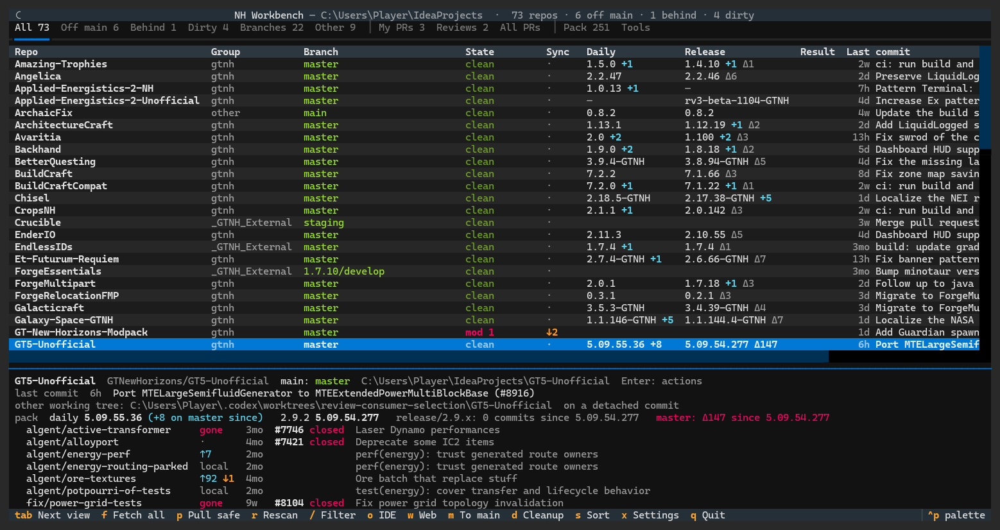
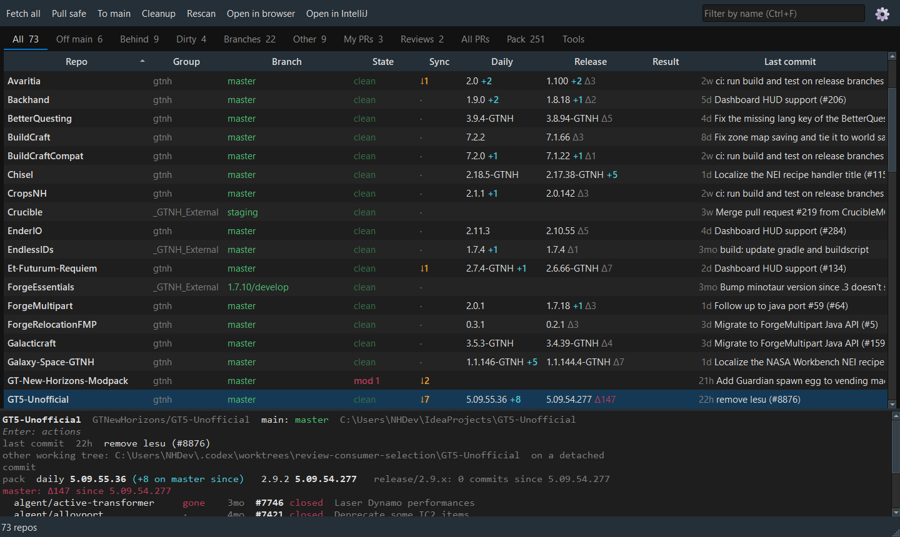

# NH Workbench

Keeps a folder full of GTNH mod checkouts under control:

- which repos are off their main branch, behind, or dirty, at a glance
- fetch everything, and fast-forward main where it is safe, even while you are on a feature branch
- local branches with their PR, and cleanup of the merged ones
- your PRs, your review requests, and every open PR of the org, sortable by size
- where each repo stands in the pack: daily and release versions, what still needs a backport
- clone missing pack mods, download the closed-source jars
- read spark profiles as text, for people and coding agents
- in the terminal, in a desktop window, or in a browser tab, with the same tabs and keys

Works on Windows, Linux and macOS. Everything else is in the [wiki](https://github.com/Algent/NH-Workbench/wiki).



## Getting started

You need [uv](https://docs.astral.sh/uv/), `git`, and the [`gh` CLI](https://cli.github.com/), logged in.
Without `gh`, everything but the PR information still works.

```
uv sync
uv run nh-workbench                       # terminal UI
uv run --extra desktop nh-workbench gui   # desktop UI (installs Qt, about 100 MB)
uv run --extra web nh-workbench web       # the terminal UI in a browser tab
uv tool install -e .                      # optional: puts `nh-workbench` and its short name `nhwb` on PATH
```

Or use a launcher from the checkout. Each one brings the environment up to date first, so you can run it
directly or point a shortcut at it:

| UI | Windows | Linux, macOS | Notes |
|---|---|---|---|
| Terminal | `nh-workbench.cmd` | `nh-workbench.sh` | Passes command-line arguments through |
| Desktop | `nh-workbench-desktop.cmd` | `nh-workbench-desktop.sh` | Installs Qt the first time; no console window on Windows |
| Browser | `nh-workbench-web.cmd` | `nh-workbench-web.sh` | Passes command-line arguments through |



More on the desktop UI, and on installing it as a tool: [Desktop UI](https://github.com/Algent/NH-Workbench/wiki/Desktop-UI).

Checkouts are read from `IdeaProjects` in your home folder. To use another folder, pass `--root`, set `root` in
the config, or change it in Settings in the UI.

### Coming from gtnh-devenv-tools

NH Workbench used to be called gtnh-devenv-tools. On its first start, it moves the old config and cache folders
to the new ones (unless those already exist) and updates the installed skill. The old `gtnh-dev` command and the
`gtnh-dev.cmd` / `gtnh-dev.sh` launchers still work, so existing shortcuts keep working.

## Documentation

- [Terminal UI](https://github.com/Algent/NH-Workbench/wiki/Terminal-UI): tabs, keys, the repo menu and Settings
- [Desktop UI](https://github.com/Algent/NH-Workbench/wiki/Desktop-UI): starting it, what differs, themes
- [Command line](https://github.com/Algent/NH-Workbench/wiki/Command-Line): every command and its options
- [spark profiles](https://github.com/Algent/NH-Workbench/wiki/Spark-Profiles): lag and memory reports as
  text, and the skill for Claude Code, Codex and OpenCode
- [What the tool will and won't do](https://github.com/Algent/NH-Workbench/wiki/Safety): pull, branch
  cleanup, PR checkout, worktrees, forks
- [Pack and GitHub data](https://github.com/Algent/NH-Workbench/wiki/Pack-and-GitHub-Data): where the versions
  and PR information come from
- [Configuration](https://github.com/Algent/NH-Workbench/wiki/Configuration): config file, settings, groups,
  IntelliJ
- [Development](https://github.com/Algent/NH-Workbench/wiki/Development): tests, how the code is laid out, the
  wiki and its screenshots, the spark mod table

## Development

```
uv run --extra desktop pytest   # without the extra, the desktop UI's tests are skipped
uv run ruff check
uv run ruff format --check
```

GitHub Actions runs all three on Linux, Windows and macOS for every push and pull request. The rest (code layout,
editing the wiki, retaking screenshots, regenerating the spark mod table) is on the
[Development](https://github.com/Algent/NH-Workbench/wiki/Development) page.

## License

[LGPL-3.0](LICENSE).
