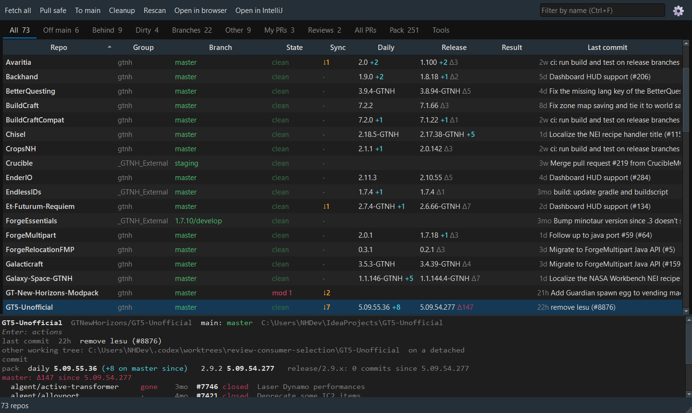

# Desktop UI

The same tabs, data and actions as the [terminal UI](Terminal-UI), in a window: Qt (PySide6), sortable
columns, resizable panes, right-click menus, and Textual's themes.

## Starting it

It needs Qt, an optional extra of about 100 MB.

- `nh-workbench-desktop.cmd` (Windows) or `nh-workbench-desktop.sh` (Linux, macOS) in the checkout installs it
  the first time, brings the environment up to date, and starts the desktop UI; on Windows no console window
  stays open. Point a shortcut at it.
- From a terminal: `uv run --extra desktop nh-workbench gui`. Once installed, `nh-workbench gui` (or `nhwb gui`),
  where `--root PATH` works as for the other commands.
- Installed as a tool, `uv tool install -e ".[desktop]"`, it is `nh-workbench-desktop` on the PATH.

The terminal UI's launchers leave the extra installed, so both can be used from one checkout.

Warnings and errors, unhandled ones included, go to `gui.log` in the cache folder (Settings, Open logs and
cache folder); `nhwb -v gui` logs every command run there too.

## Tabs and the detail pane

The tabs are the terminal UI's, with the same counts and filters: see its [tabs](Terminal-UI#tabs). The pane
under the list shows the selected line's details, as in the terminal UI, and can be resized by dragging the
divider.

Columns size themselves to their contents until you drag one. Clicking a header sorts by that column.

## Actions

- **Toolbar**: the actions of the current tab, the same set the terminal UI's footer shows.
- **Menu of a line**: `Enter`, double click or right click. On a repo: fetch, pull, switch to main, delete
  merged branches, protect branches, open in IntelliJ, on GitHub or in the file manager, set the main branch or
  group, hide the repo. On a pack mod or a PR: clone, check out, open.
- **Cleanup** and **To main** list what they will do and ask first; `No` is the default.
- Tools tab: `Enter` on a tool runs it. spark profiles open in a window of their own, with an overview, call
  tree, tables and the text report ([spark profiles](Spark-Profiles#desktop-ui)).
- **History**, at the right of the status bar: earlier messages, newest first, with the time. It counts the
  warnings you have not seen yet; when a clone or download fails for several mods, each failure is there.
  `Ctrl+C` copies the selected lines.

## Keys

The terminal UI's [keys](Terminal-UI#keys) work the same way, on the same tabs: `f`, `p`, `F`, `P`, `r`, `m`,
`d`, `o`, `w`, `c`, `t`, `v`, `s`, `/`, `Tab`, `x`, `q`. The menus answer to their letters too. Besides those:

| Key | Action |
|---|---|
| `Ctrl+F` | Filter by name (`Esc` clears it, `Enter` goes back to the list) |
| `F5` | Rescan, or refresh from GitHub on the PR tabs |
| `Ctrl+Tab` / `Ctrl+Shift+Tab` | Next / previous tab |
| `Ctrl+,` | Settings |
| `Ctrl+Q` | Quit |

Each toolbar button's tooltip gives its letter and its shortcut. Both can be changed: Settings, Keys. The
letters are shared with the terminal UI; `Tab`, `Ctrl+Tab`, `Esc` and the letters inside menus stay as they are.

## Settings

The cog at the end of the toolbar, `x` or `Ctrl+,`: theme, text size, repo folder, clone over SSH or HTTPS,
auto-refresh interval and whether it fetches, IntelliJ launcher (or none), hidden repos and protected branches.
Save writes them to the config file, keeping its comments. Its buttons download the pack data again, open the
config or cache folder, change the keys and shortcuts (a dialog of its own, saved with its own Save), and update the tool itself (as in the terminal UI, a message says when its checkout has
new commits).

## Themes

Textual's themes, the ones the terminal UI offers: Textual dark (the default), Dracula, Nord, Gruvbox,
Catppuccin, Tokyo night, Solarized, Rose pine and more, light ones included, or the system's own colours. The
theme is one setting for both UIs: picking one in either applies to the other at its next start. See
[Configuration](Configuration) for `theme` and `font_size`.
