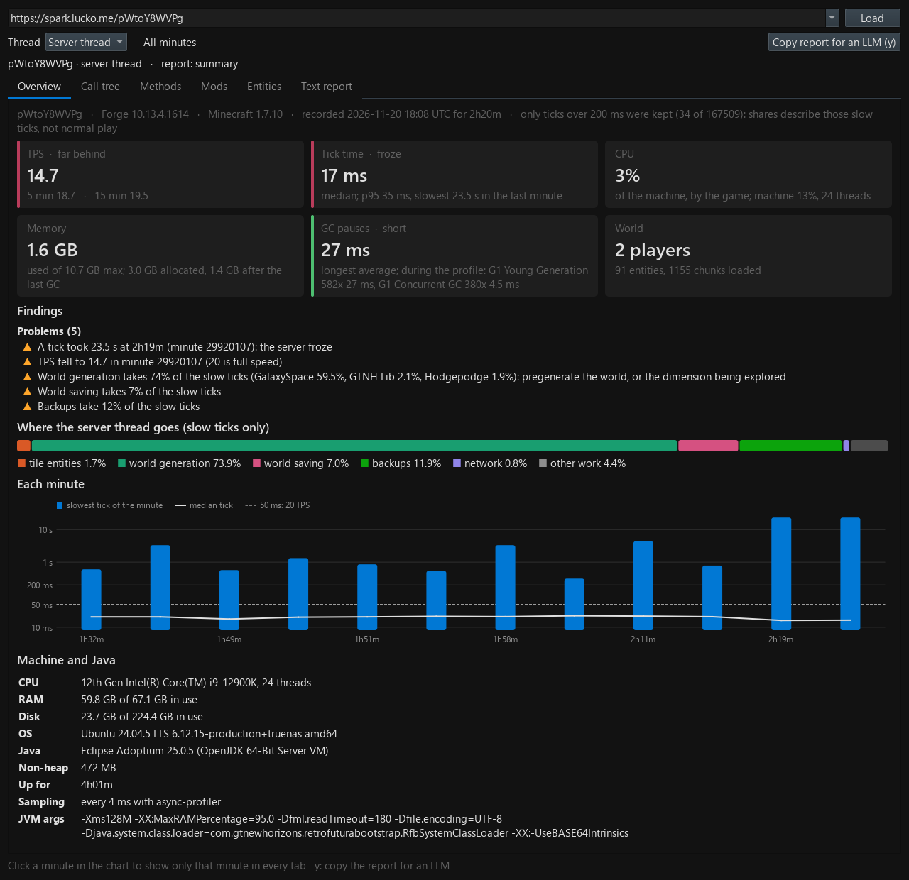

# spark profiles

Turns a [spark](https://spark.lucko.me) link, the one players paste when reporting lag, into a short report that
people and LLMs can both read: a few thousand tokens of text, no screenshots. It needs no checkouts.

In either UI: **Tools** tab, Enter on **spark**, then paste a link or a code, or pick a saved profile. From the
command line:

```
nh-workbench tools spark summary https://spark.lucko.me/XXXXXXXXXX
nh-workbench tools spark tree XXXXXXXXXX makeCrater                 # what a method calls, all call sites merged
nh-workbench tools spark callers XXXXXXXXXX ASMEventHandler.invoke  # who calls it
nh-workbench tools spark compare EARLIER LATER                      # two heap summaries: what grew
```

## Desktop UI



| Tab | What it shows |
|---|---|
| Overview | Cards for TPS, tick time, CPU, memory, GC pauses and the world, with a coloured stripe when one looks wrong. The findings, a bar of where the main thread's time goes (hover a part for its mods), a chart of each minute, the machine and Java. Click a minute in the chart to show only that minute in every tab. |
| Call tree | What the thread does, as a tree with a share bar per row. Bold and `[Mod]` mark where a mod's code starts. Type a method and press Enter, or right click a row, for what it calls or who calls it. |
| Methods, Mods | Sortable, filterable tables of own and total time. Double click a mod to list its methods. |
| Entities | By type, by world, and every chunk with entities. Double click a chunk to copy a `/tp` to it. |
| Memory by class | For a heap summary: every class and the total per mod. **Compare with** another summary to add how much each grew. |
| Text report | The report itself, with the same keys as the terminal UI. |

- **Copy report for an LLM** (`y`) is always at the top. It copies what the Text report tab shows.
- The thread picker switches every tab to another thread.
- The saved profiles list shows when each was recorded and downloaded. The cross deletes one (it asks first).


## Terminal UI

The report and these keys (the defaults: change them in Settings > Keys, in either UI):

| Key | Action |
|---|---|
| `Enter` | On a method: what it calls. On one of the worst minutes: only that minute |
| `t` / `c` | What the method on the cursor line calls / who calls it (asks for a method when the line has none) |
| `w` / `h` | Pick a minute / a thread |
| `s` | Straight back to the summary |
| `y` / `e` | Copy the report (for an LLM) / save it as a file |
| `o` / `r` | Open another profile / download this one again |
| `m` | On a heap summary: compare it with another one |
| `Esc` | Step back (on the summary: close). In the desktop window, `Esc` never closes. |
| `q` | Close |

## Command line

| Option | Effect |
|---|---|
| `--thread NAME` | Another thread than the server (or client) thread |
| `--window ID` | Only that minute, as listed under "Worst minutes". Repeatable |
| `--min`, `--lines` | How much of the call tree to show |
| `--refresh` | Download again instead of using the saved copy |

A link, a code, or a downloaded `.sparkprofile` / `.sparkheap` file all work. Downloads are kept in the cache
folder under `spark`. The name and UUID of whoever recorded the profile are left out of every report.

## Reading a report

In order, a summary has:

1. **The setup:** platform and pack versions, how it was recorded (every tick, or only ticks over N ms, which
   changes what the percentages mean), TPS and tick times, memory and GC, the machine, Java and JVM arguments.
2. **Findings:** what stands out (below).
3. **Worst minutes**, with an id that works with `--window`.
4. **Entities** by type, by world, and the busiest chunks with their block coordinates.
5. **The main thread:** methods with the most own and total time, own time per mod, and the hot call paths.

### Findings

Rules of thumb for GTNH: `[warn]` for problems, `[info]` for notes.

- **Ticks:** frozen ticks; when they recur, the command that records only those. Low TPS, also worked out from
  the ticks the profile counted. Autosaves long enough to stutter.
- **Where the time goes:** entities, tile entities, world generation, chunk loading, lighting, saving, backups and
  network, with the mods behind each. On a client also rendering, client ticks and waiting for the GPU. Work set
  off inside other work counts for the inner kind: world generation set off by a packet is world generation.
- **Headroom:** how long the main thread waits, between ticks on a server, for the next frame on a client.
- **Memory:** long GC pauses (a single one at world load is only a note), a small heap, a nearly full one.
- **Machine:** 32-bit Java, few CPU threads, swap in use while RAM is full, little disk space left.
- **Mods and setup:** a mod taking a large share by itself, an entity pile-up in one chunk, Thermos (or another
  Bukkit on Forge server) and its share, and an Opis profiling run going on while spark recorded.

### Heap summaries

`/spark heapsummary` reads the same way: the biggest classes in memory and the total per mod. Comparing two shows
what grew, which is how a leak shows.

- The earlier of the two is always the start, whichever you load first.
- If the game restarted between the two, the comparison says so: the differences are then two separate starts,
  not growth.
- Lambdas (`Foo$$Lambda/0x...`) get a new address every run. They are counted under one name, so the same lambda
  matches across runs.

### How names and mods are worked out

- **Method names:** Minecraft's `func_` names become their MCP names (stable 12, what 1.7.10 development uses),
  from mappings downloaded once from Forge's Maven. Offline, they stay as they are.
  - A method stable 12 left unnamed takes the name from the nearest later version (1.8.9, 1.10.2, then 1.12),
    with its id kept: `updateBlocks/func_147456_g`. The 1.7.10 code still calls it `func_147456_g`.
  - A mixin's suffix stays: `renderWorld$surround`.
- **Mods:** 1.7.10 profiles don't say which mod a class comes from, so the tool ships a table of package prefixes
  per mod. A package it doesn't know shows as `<package> (package)`.
- **Own time per mod:** time in libraries (Java, netty, fastutil, guava, LWJGL…) and native code counts for the
  nearest mod up the call stack, else Minecraft or Forge. A backup's disk writes count for the backup mod.
- **Pack versions:** recent spark versions list the mods, so the header names GregTech, the NH Coremod, GTNH Lib,
  Hodgepodge, Angelica and lwjgl3ify with their versions.
- **Units:** binary, as Java and spark's viewer count them: `-Xmx20G` reads 20 GB.

## Skill for Claude Code, Codex and OpenCode

A `spark-profile` skill lets coding agents read a spark link pasted in any project with these commands, instead
of opening the web viewer. Install it from the command line, or with F2 where the spark screen asks for a link:

```
nh-workbench tools install-skill    # for the agents found in your home folder; --for claude|codex|opencode|all
```

It goes in `~/.claude/skills` (Claude Code), `~/.agents/skills` (Codex) or `~/.config/opencode/skills`
(OpenCode). It runs through a small launcher that needs only uv, and uses, in this order:

1. the checkout it was installed from
2. `nh-workbench` (or the old `gtnh-dev`) on PATH
3. the published version from GitHub, through `uvx`. The agent then offers once to point it at a checkout.
