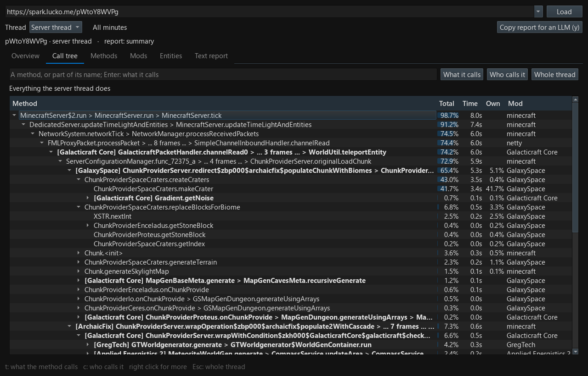

# spark profiles

Turns a [spark](https://spark.lucko.me) profile, the link players paste when reporting lag, into a short text
report that reads well for people and LLMs alike (a few thousand tokens, no screenshots). This needs no
checkouts.

```
nh-workbench tools spark summary https://spark.lucko.me/XXXXXXXXXX
nh-workbench tools spark tree XXXXXXXXXX makeCrater                # what a method calls, all its call sites merged
nh-workbench tools spark callers XXXXXXXXXX ASMEventHandler.invoke  # who calls it
```

## What the report shows

The summary starts with the setup:

- the platform, and how the profile was recorded: every tick, or only ticks over N ms. This changes how to read
  the percentages.
- TPS, MSPT and uptime
- memory: heap used, allocated and max, the old generation after the last GC, and GC during the profile and
  since start
- CPU, swap, disk, Java and JVM arguments

Then come the findings and the worst minutes. For the server thread, it lists the methods with the most own time
and total time, own time per mod, and the hot call paths, with `[Mod]` where a mod's code starts. Entities are
listed by type, by world, and the busiest chunks with their block coordinates.

Findings are rules of thumb for GTNH, `[warn]` for problems and `[info]` for notes: frozen ticks (and, when
they recur, how to record only those), low TPS (from the ticks the profile counted, too), autosaves long
enough to stutter, long GC pauses, a small or nearly full heap, 32-bit Java, few CPU threads, swap in use while
RAM is full (not on Windows, whose figures mislead), little disk space left, a mod taking a large share, an
entity pile-up in one chunk, and Thermos or another Bukkit on Forge server with its share. They also show where the main thread's time goes (entities, tile
entities, world generation, chunk loading, lighting, saving, backups, network; on a client also rendering,
client ticks and waiting for the GPU) and how long it waits, which is its headroom: between ticks on a server,
for the next frame on a client (Angelica's frame pacer or the frame limit). Work set off inside other work
counts for the inner kind, so world generation set off by a packet counts as world generation.

Profiles from recent spark versions list the mods: the header names the versions of GregTech, the NH Coremod,
GTNH Lib, Hodgepodge, Angelica and lwjgl3ify, which tell which build of the pack it is.

Sizes are in binary units, as Java and spark's viewer count them: `-Xmx20G` reads 20 GB.

Heap summaries (`/spark heapsummary`) read the same way. `summary` lists the biggest classes in memory and the
total per mod. `compare EARLIER LATER` shows what grew between two of them, which is how a leak shows. In the
terminal UI, `m` on a heap summary compares it with another (earlier or later: the earlier one is the start).
A comparison says when the game restarted between the two, as their differences are then two separate starts,
not growth. Lambdas (`Foo$$Lambda/0x...`) sit at a new address every run: they are counted under one name, so
the same lambda matches across runs.

- Method names: Minecraft's `func_` names are replaced with their MCP names (stable 12, what 1.7.10 development
  uses), from mappings downloaded once from Forge's Maven into the cache folder. Offline, the names stay as is.
  A method stable 12 left unnamed takes its name from the nearest later version (1.8.9, 1.10.2, then 1.12),
  since a `func_` number stays with its method: `func_147456_g` reads `updateBlocks`. A mixin's suffix is kept,
  as in `renderWorld$surround`.
- Own time per mod: time in native code, the JVM and libraries (netty, fastutil, guava) counts for the nearest
  mod up the call stack, else Minecraft or Forge. A backup's disk writes count for the backup mod, not for
  "native code".
- Mods: 1.7.10 profiles do not say which mod a class comes from, so the tool ships a table of package prefixes
  per mod. Anything it misses is shown as `<package> (package)`.

## In the UI

On the Tools tab, press Enter on spark, then paste a link or pick a saved profile. On the report, these keys
work (they are the defaults; change them in Settings > Keys):

| Key | Action |
|---|---|
| `Enter` | On a method: what it calls. On one of the worst minutes: narrow to it |
| `t` / `c` | What the method on the cursor line calls / who calls it (asked for when the line has none) |
| `w` / `h` | Pick a minute / a thread |
| `s` | Jump straight to the summary |
| `y` / `e` | Copy the report (for an LLM) / save it as a file |
| `o` | Open another profile |
| `r` | Download the profile again |
| `m` | On a heap summary: compare it with another one |
| `Esc` | Step back to the previous view (on the summary: close) |
| `q` | Close |

## Desktop UI


The spark window has the same text report under **Text report**, with `t`, `c`, `s` and `y` (`Esc` there steps
back but never closes the window), plus tabs to browse the profile. **Copy report for an LLM** (`y`) is always at
the top.

- **Overview:** cards for TPS, tick time, CPU, memory, GC pauses and the world, each with a coloured stripe
  when it looks wrong. Then come the findings, a bar of where the server thread's time goes (hover a part for
  its mods), a chart of each minute (slowest tick, median tick, the 50 ms line), and the machine and Java.
  Click a minute in the chart to show only that minute in every tab.
- **Call tree:** what the thread does as an expandable tree with a share bar per row. `[Mod]` and bold mark
  where a mod's code starts. Type a method and press Enter, or right click a row, for what it calls or who
  calls it. `t` and `c` do the same on the current row, and `Esc` goes back to the whole thread.
- **Methods**, **Mods**: sortable, filterable tables of own and total time. A double click on a mod lists its
  methods.
- **Entities:** by type, by world, and every chunk with entities. Right click or double click a chunk to copy
  a `/tp` command to it.
- For a heap summary, **Memory by class** lists every class and the total per mod. **Compare with** another
  one (a saved one, a link or a code) adds how much each class and mod grew, sorted by growth, and the text
  report becomes the growth report. The earlier of the two is the start, whichever you loaded first.

The thread picker at the top switches every tab to another thread.



## On the command line

`--thread NAME` picks another thread, `--window ID` (repeatable) narrows everything to the minutes listed under
"Worst minutes", `--min` and `--lines` control how much of the call tree is shown. A link or code also accepts a
downloaded `.sparkprofile` file. Downloads are kept in the cache folder under `spark`; `--refresh` downloads
again. The name and UUID of whoever recorded the profile are left out of the reports.

## Skill for Claude Code, Codex and OpenCode

A `spark-profile` skill lets coding agents read a spark link pasted in any project with these commands, instead
of opening the web viewer. Install it from the command line, or with F2 where the spark screen asks for a link:

```
nh-workbench tools install-skill    # for the agents found in your home folder; --for claude|codex|opencode|all
```

It goes in `~/.claude/skills` for Claude Code, `~/.agents/skills` for Codex, and `~/.config/opencode/skills` for
OpenCode.

The skill runs through a small launcher that needs only uv. It uses, in this order:

1. the checkout it was installed from
2. `nh-workbench` (or the old `gtnh-dev`) on PATH
3. the published version from GitHub, through `uvx`. The agent then offers once to point it at a checkout.
