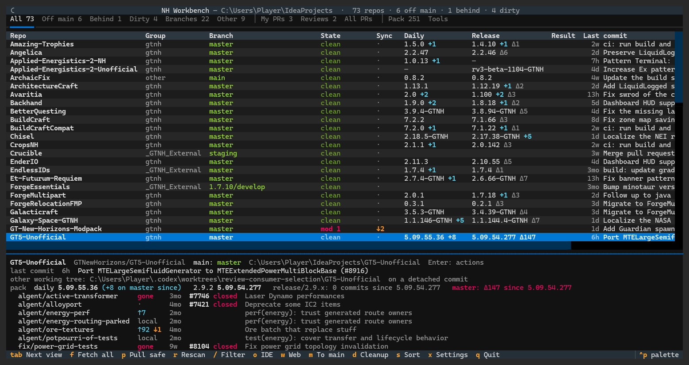

# Terminal UI

Start it with `nh-workbench` (or `nhwb`) and no command, or with the `nh-workbench.cmd` / `nh-workbench.sh`
launchers. For the same in a window, see [Desktop UI](Desktop-UI).

## In a browser

`nh-workbench web` shows the terminal UI in a browser tab instead. Install it first with `uv sync --extra web`,
or use the `nh-workbench-web.cmd` / `nh-workbench-web.sh` launchers, which install it the first time.

Each browser tab runs its own copy of the UI on this computer. Links open in the browser; the IDE and folders open
on this computer.

## Tabs

| Tab | Shows |
|---|---|
| All, Off main, Behind, Dirty, Branches, Other | Repos, one line each, filtered |
| My PRs | Your open PRs across GitHub, with review and CI state and the local branch they come from |
| Reviews | Open PRs asking for your review personally (`t` adds the ones that reach you through a team) |
| All PRs | Every open PR of the org, marked when you wrote it, are asked to review it, or reviewed it |
| Pack | Every mod of the current daily and the latest release, and whether it is checked out |
| Tools | spark profiles, clone missing repos, closed-source jars, clean built jars, install the AI skill |

The panel at the bottom gives details on the selected line: branches and their PRs, the last commit, and the
commits waiting on the release branch.

While a fetch, pull, cleanup or clone runs, a bar above the keys shows how far it got, the time left and the
last repo done. In the Result column, repos it is on spin and repos still to do say `waiting`.

## Keys

| Key | Action |
|---|---|
| `Enter`, click | Repo tabs: menu for that repo. PR tabs: open the PR |
| `Tab` / `Shift+Tab` | Next / previous tab |
| `/` | Filter by name. On PR tabs, `<200` keeps PRs under 200 changed lines |
| `s`, click on a header | Sort. PR tabs: last update, smallest, largest, repo |
| `f` / `p` | Fetch all / pull all where safe (`F` / `P`: selected repo only) |
| `r` | Rescan. On My PRs and Reviews: refresh them from GitHub. On All PRs: search GitHub again |
| `m` | Switch repos parked on a merged PR branch back to main |
| `d` | Delete merged branches |
| `o` / `w` | Open in IntelliJ / open the PR or GitHub page |
| `e` / `T` | Open the selected repo in the file manager / in a new terminal window |
| `t` | Reviews: show team requests. All PRs: show drafts |
| `v` | All PRs: show only some PRs (see below) |
| `c` | Pack tab: clone the selected mod. PR tabs: check out the PR in its local repo |
| `C` / `L` | Open the config folder / the logs and cache folder |
| `x` | Settings |
| `q` | Quit (also closes menus) |

`v` on All PRs keeps only the PRs that match the filters you tick: in repos checked out here, in pack mods,
without any review, or not updated for 30 days or more.

These are the defaults; change them in Settings (`x`), Keys. `Tab`, `Esc`, `Enter` and the letters inside menus
cannot be changed.

## Repo menu

`Enter` on a repo opens its menu: fetch, pull, switch to main, delete merged branches, open in IntelliJ, on
GitHub, in the file manager or a terminal, set the main branch or group, protect branches from cleanup, hide the
repo.

## Settings

`x` opens Settings:

- auto-refresh interval, and whether auto-refresh fetches (off by default)
- IntelliJ launcher
- clone over SSH or HTTPS
- refresh the pack data
- change the repo folder
- the keys (see below)
- show a hidden repo again, or unprotect a kept branch
- open the config or cache folder
- update the tool itself: its checkout is fetched at start, and a notification says when there are new commits.
  Restart it after updating.

To change a key, press `Enter` on an action, then the new key (`Backspace` puts back the default). A key already
taken on one of that action's tabs is refused. Actions that are never on the same tab may share a key, as `r`
does. The keys are shared with the desktop UI.

Settings changed from the UI are written to the config file, keeping its comments. See
[Configuration](Configuration) for everything the file holds.
